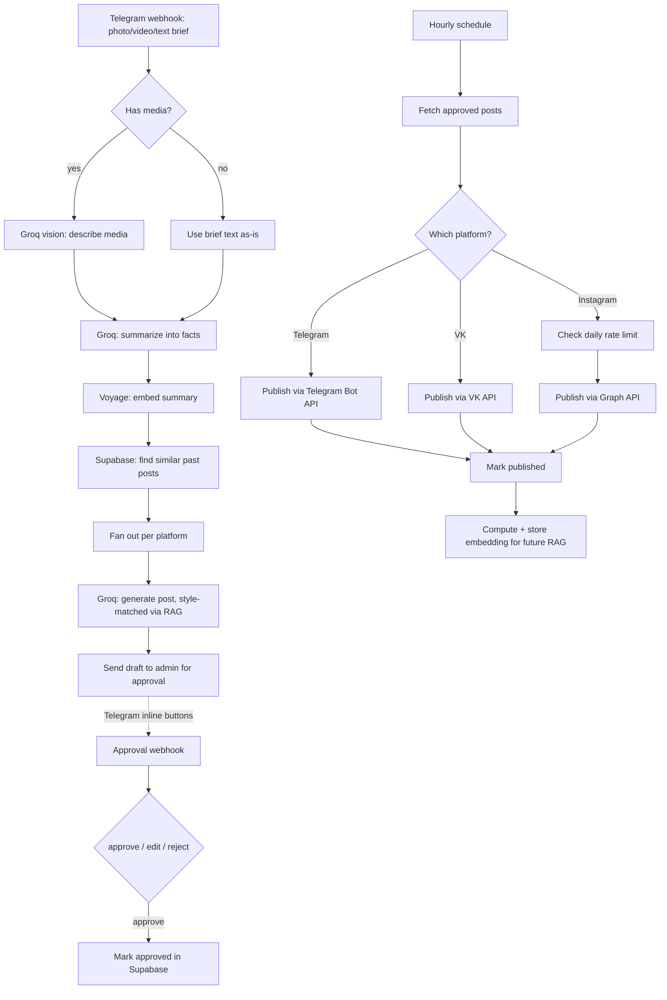

# AI Content Pipeline (n8n)

A sanitized, generic version of an automation pipeline I built for a real
client: it turns a raw photo/video/text brief sent via Telegram into
platform-tailored social media posts, routes them through a human approval
step, and publishes them on a schedule — while keeping each platform's
tone/length rules and a growing style memory so new posts stay consistent
with past ones.

(Business-specific prompts, table names and the real client's data have
been replaced with generic placeholders — the workflow files are otherwise
structurally identical to what's running in production.)

## Architecture

## Why it's built this way

- **RAG for style consistency, not knowledge retrieval.** The vector
  search isn't looking up facts — it retrieves the 2-3 most similar
  *previously published* posts so the generation prompt can match an
  established voice instead of drifting post to post.
- **Vision model output is treated as untrusted input to the writer
  prompt**, with an explicit instruction not to invent details beyond
  what's visible — this cuts down on hallucinated specifics (wrong
  event type, invented people in frame, etc.) that a single end-to-end
  prompt tends to produce.
- **Human approval sits between generation and publishing.** Every
  draft goes to an admin chat with inline Approve/Edit/Reject buttons
  before anything goes out publicly.
- **Per-platform fanout instead of one generic post.** Telegram, VK and
  Instagram get separately generated copies with their own tone/length
  rules, not one post cross-posted three times.
- **Instagram publishing checks a daily quota before posting**, since
  the Graph API rate-limits and a naive scheduler would eventually trip it.

## Workflows

| File | Purpose |
|---|---|
| `workflows/1-intake-and-generation.json` | Telegram intake → vision/summary → RAG lookup → per-platform generation → send for approval |
| `workflows/2-approval.json` | Handles the approve/reject callback and updates status |
| `workflows/3-scheduled-publish.json` | Hourly: publishes approved posts per platform, respects rate limits, stores embeddings for future RAG |

Importable directly into n8n (Workflows → Import from File). Needs your
own `GROQ_API_KEY`, `VOYAGE_API_KEY`, `SUPABASE_URL`/`SUPABASE_KEY`,
`TELEGRAM_BOT_TOKEN` and platform tokens as n8n environment variables to
actually run — this repo is an architecture reference, not a plug-and-play
deployment.

## Stack

n8n, Groq (LLM + vision), Voyage AI (embeddings), Supabase (Postgres +
pgvector), Telegram Bot API, VK API, Instagram Graph API.
